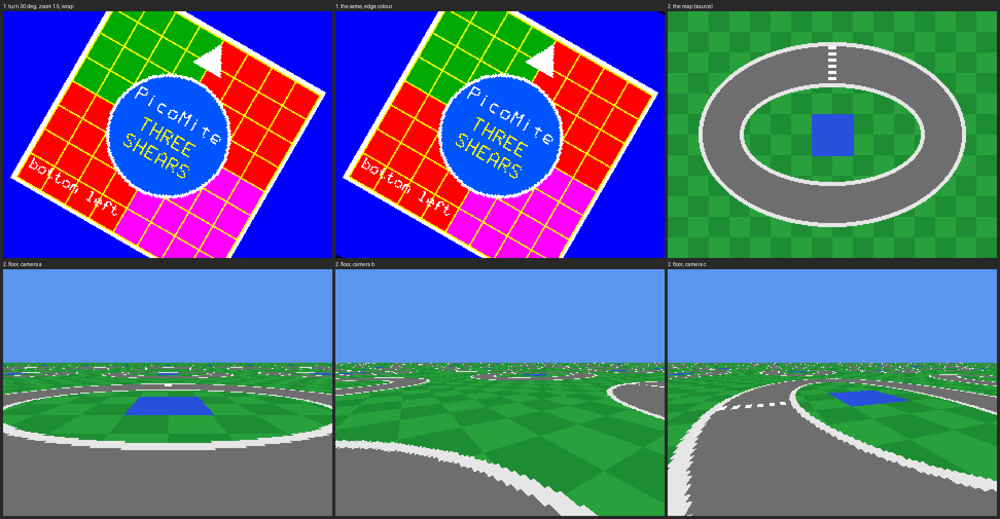
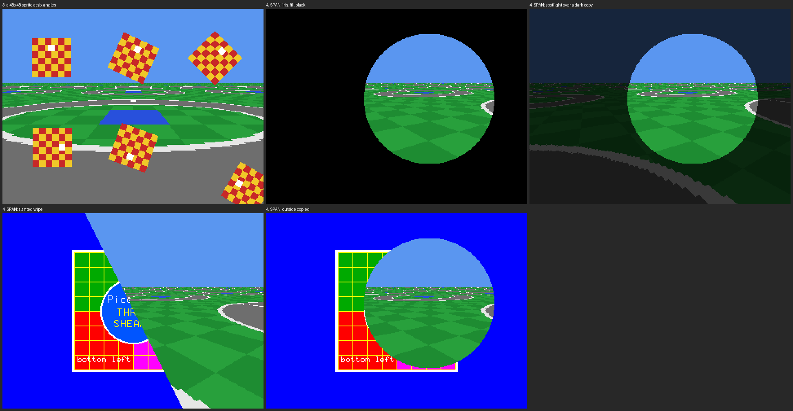

# FRAMEBUFFER AFFINE and SPAN: a turned and scaled row copy, and a per-row window

*25 November 2026. Built the same day on the PicoMite (graphics/Warp.c) and agreed by Peter (section 15): sections 12
and 14 give what was measured and tested. It covers the VGA and HDMI builds; the Colour Maximite 2, as built on 26
November, is section 13. The pictures
were made by a model of the rules below (tools/affine_span_model.py); scenes 5 to 7 of Bas/warp_demo.bas show the same
on the firmware.*

## 1. What they are for

FRAMEBUFFER WARPH and WARPV move the rows and columns of a picture. Two things they cannot do are the subject of
this note.

**AFFINE: scale and turn.** WARP never changes the size of anything along a row. The video chips that could
(the SNES's Mode 7, the Game Boy Advance's affine backgrounds, the Saturn's rotation layer, Sega's road hardware)
read each screen line from the picture along a straight line of any direction and length. One command that does
the same gives:
- a picture turned through any angle and zoomed, in one pass;
- a floor in perspective (F-Zero, Mario Kart), when each row has its own line;
- a row made wider or narrower by its own amount (a road that narrows properly, a cylinder, a flag);
- sprites turned and scaled, when the copy is limited to a rectangle.

**SPAN: a window with a shape.** On the SNES a window's left and right edges could change on every line, which is
how its games close a circle on the hero, light a cave with a torch, and wipe between scenes along a curve. One
command that copies only between a left and a right column, given for each row, does the same.

**What can be done today, measured on the PC3 at 315 MHz in MODE 2 on 25 Nov** (Bas/warp_demo.bas scene 4 uses the
first):

| Today | Time | Limits |
|---|---|---|
| A turn by three shears (WARPH, WARPV, WARPH) | 7.2 ms, 75 frames a second | −90 to 90 degrees; no zoom; two workspace buffers; the picture within 113 pixels of the screen's centre |
| BLIT RESIZE of the whole screen | 11.0 ms | scale only, a rectangle at a time; MODE 2 and 3 only |
| A circular window: a BLIT FRAMEBUFFER for each row | 4.2 ms, plus 1.2 to 1.7 ms to make the tables | nothing is filled outside the circle |

## 2. Names

**AFFINE and SPAN (Peter, 25 Nov).** The other names considered:
- **AFFINE**: the mathematical name of the mapping. Others: WARPA (in the WARP family), ROTOZOOM (the demo coders'
  word).
- **SPAN**: each row's run of pixels. The SNES's word is "window", but the CMM2 already has FRAMEBUFFER WINDOW (the
  screen's place in the world), so WINDOW is not free. Others: CLIPH, MASK, IRIS.

## 3. AFFINE: syntax

```
FRAMEBUFFER AFFINE from, to, u%(), v%(), du%(), dv%() [, step] [, first] [, left] [, width] [, edge] [, transparent]
```

| Argument | Meaning | Default |
|---|---|---|
| `from`, `to` | The buffers, as WARPH takes them. They must differ. | — |
| `u%()`, `v%()` | For each band, the place in the source that the band's first pixel shows (x and y), in 1/65536 of a pixel. | — |
| `du%()`, `dv%()` | For each band, how far that place moves for each pixel to the right, in the same units. | — |
| `step` | The number of rows that each element covers: 1 up to the buffer's height. | 1 |
| `first` | The first row to draw: −16,777,216 to 16,777,216. | 0 |
| `left` | The first column to draw: the same range. | 0 |
| `width` | The number of columns to draw: 1 to 16,777,216. | the buffer's width |
| `edge` | What a pixel gets when its place is outside the source: omitted means the source wraps round; −1 leaves the pixel as it is; a colour fills it. As WARPH. | wrap |
| `transparent` | A source pixel of this value is not written. As WARPH. | none |

The four arrays are 1D integer arrays with the same number of elements, one element for each band of `step` rows.
The order keeps WARPH's (step, first, …, edge, transparent), with the two new position arguments after `first`.

## 4. AFFINE: what each pixel gets

The rule is written for one pixel, in whole-number arithmetic, so that every build gives the same picture.

- Let the arrays have `n` elements. Band `b` (0 to n−1) covers the rows `first + b*step` to `first + b*step + step − 1`.
- In band `b`, take row `j` of the band (0 to step−1) and column `i` of the window (0 to width−1). The pixel is the
  destination's (`left + i`, `first + b*step + j`). If that is off the buffer, nothing is drawn.
- Its place in the source is:

  ```
  U = u(b) − j*dv(b) + i*du(b)          sx = U / 65536, rounded down (towards minus infinity)
  V = v(b) + j*du(b) + i*dv(b)          sy = V / 65536, rounded down
  ```

- **edge omitted:** sx is taken modulo the source's width and sy modulo its height. Every value of the four
  arrays is allowed, so a camera position can keep growing.
- **edge = −1:** if (sx, sy) is outside the source, the destination pixel is left as it is.
- **edge = a colour:** those pixels get the colour, whatever `transparent` is.
- **With an edge (−1 or a colour)** a place (u, v) beyond ±2^60 or a step (du, dv) beyond ±2^35 is taken as
  that limit, so that no sum can overflow. That is 17 million million pixels, and half a million pixels a step.
- **transparent:** a source pixel of that value is not written. The value is given as WARPH takes it.

Three points about the rule:

1. **Along a row** the place moves by (du, dv) for each pixel. du = 65536 and dv = 0 is the picture at its own size
   and angle. Halving both doubles the picture's size.
2. **Down a band** each next row starts one step on at right angles, (−dv, du). So **one element with step = the
   screen's height turns and zooms the whole picture** with no tables at all (5.1). For a floor, where every row
   has its own line, step is 1 and this rule does nothing. With step 2 a floor is approximate: the direction of
   the second row is right but its distance is not.
3. **`first` and `left` can be negative or past the edge**, and the part of the window off the buffer is not
   drawn; i and j still count from the window's own corner. A sprite can then slide off the screen with no change
   to its tables. (WARPH and WARPV refuse an array that reaches past the buffer. Section 15, decision 4.)

The place rounds down. To sample from the middle of a pixel, add 32768 to u and v.

## 5. AFFINE: examples

The formulas were first run through the model, whose pictures are below. Examples 5.1 to 5.3 then ran on the
firmware, as scenes 5 to 7 of Bas/warp_demo.bas, with the same result. All are MODE 2, 320x240.



### 5.1 A turn and zoom of the whole picture

One element. The screen's centre (160, 120) shows the picture's (160, 120), turned `a!` clockwise and `z!` times
its size (top row of the pictures, at 30 degrees and 1.5 times).

```basic
CONST FP = 65536
DIM u(0), v(0), du(0), dv(0)
DO
  a! = a! + 0.02 : z! = 1.5 + SIN(a! * 0.7)
  du(0) = FP * COS(a!) / z! : dv(0) = -FP * SIN(a!) / z!
  u(0) = FP * 160 - 160 * du(0) + 120 * dv(0)
  v(0) = FP * 120 - 160 * dv(0) - 120 * du(0)
  FRAMEBUFFER WAIT
  FRAMEBUFFER AFFINE F, N, u(), v(), du(), dv(), 240
LOOP
```

### 5.2 A floor

F holds a map seen from above (top right picture). The camera is at (camx!, camy!) on the map, looking along the
angle `a!`, `hgt!` above the ground; the horizon is row `hz`, and `d!` is the distance to the screen in pixels
(160 gives a 90 degree view). Row hz + 1 + k is `hgt! / (k + 1)` map pixels wide for each screen pixel: that table
is made once, and each frame is six MATH statements and the command (bottom row of the pictures).

```basic
CONST FP = 65536, hz = 90
DIM zt!(148), u(148), v(148), du(148), dv(148)            ' rows 91 to 239
FOR k = 0 TO 148 : zt!(k) = hgt! / (k + 1) : NEXT
DO
  ' ... the game moves camx!, camy! and a! ...
  ca! = COS(a!) : sa! = SIN(a!)
  MATH SCALE zt!(), -FP * sa!, du() : MATH SCALE zt!(), FP * ca!, dv()
  MATH SCALE zt!(), FP * (d! * ca! + 160 * sa!), u() : MATH ADD u(), FP * camx!, u()
  MATH SCALE zt!(), FP * (d! * sa! - 160 * ca!), v() : MATH ADD v(), FP * camy!, v()
  FRAMEBUFFER WAIT
  FRAMEBUFFER AFFINE F, N, u(), v(), du(), dv(), 1, hz + 1
LOOP
```

The rows above the horizon are not touched, so a sky drawn once, or moved with WARPH, stays. Near the horizon
many map pixels fall on each screen pixel and the picture shimmers, as it did on the SNES; games hide it with a
band of haze.

### 5.3 A sprite at any angle

A 48x48 sprite sits alone in buffer 2 with its centre at (124, 124), on colour 0. It is drawn turned `a!`, with
its centre at (px, py), through a window of 69x69 pixels (its diagonal). Edge −1 and transparent 0 leave
everything round it alone (first picture of the second set: six angles, one of them partly off the screen).

```basic
CONST B = 69
du(0) = FP * COS(a!) : dv(0) = -FP * SIN(a!)
u(0) = FP * 124 - (B \ 2) * (du(0) - dv(0))
v(0) = FP * 124 - (B \ 2) * (dv(0) + du(0))
FRAMEBUFFER AFFINE 2, N, u(), v(), du(), dv(), B, py - B \ 2, px - B \ 2, B, -1, 0
```

The window reads whatever lies round the sprite in its buffer, so a sprite needs a margin of the transparent
colour: a fifth of its size on every side. A sheet of sprites packed edge to edge will not do.

### 5.4 A row made wider or narrower

With dv = 0 a row is only scaled: du is 65536 divided by the scale. A road drawn flat, at one width, narrows to the
horizon with `du(k)` growing up the screen, and bends with an offset added to `u(k)`; `v(k)` picks the road's row,
as WARPH's rows%() does.

## 6. AFFINE: the size of the world

The source is one of the framebuffers, so in MODE 2 the map of a floor is 320x240 pixels and repeats beyond that
(the model's floors show the track again in the distance). That is enough for a turned picture, sprites, and a
floor of repeating ground. It is small for a racing circuit: the SNES's map is 1024x1024.

Ways to a larger world, none of them in this design:
- **A TILEMAP as the source.** This is what Mode 7 is: the place (sx, sy) picks a tile from the map and a pixel
  from the tile. It costs a second lookup for each pixel and its own code. It is the natural second step once
  the first has been measured.
- **An image in memory** (the PC3's PSRAM has the room). Reads from PSRAM out of order are slow (section 12).
- **The CMM2's world framebuffer** is already larger than the screen, and AFFINE reads it there (section 13.2).

## 7. SPAN: syntax

```
FRAMEBUFFER SPAN from, to, left%(), right%() [, step] [, first] [, fill] [, transparent] [, outside]
```

| Argument | Meaning | Default |
|---|---|---|
| `from`, `to` | The buffers, as WARPH takes them. | — |
| `left%()`, `right%()` | For each band, the first and the last column of its span. | — |
| `step` | The number of rows that each element covers: 1 up to the buffer's height. | 1 |
| `first` | The first row: −16,777,216 to 16,777,216. | 0 |
| `fill` | What the pixels of a band's rows that are not copied get: omitted or −1 leaves them as they are; a colour fills them. | left as they are |
| `transparent` | A source pixel of this value is not written. As WARPH. | none |
| `outside` | 0 copies the pixels in the span. 1 copies the pixels outside it. | 0 |

## 8. SPAN: what each pixel gets

- Let the arrays have `n` elements (both the same). Band `b` covers the rows `first + b*step` to
  `first + b*step + step − 1`. Rows off the buffer are not drawn. Rows in no band are left as they are.
- The band's span is the columns `left(b)` to `right(b)`, both included, cut to the buffer. If `left(b)` is
  greater than `right(b)` the span is empty. No value is an error.
- **outside = 0:** a pixel in the span becomes the source's pixel at the same place (unless that is the
  `transparent` value). A pixel not in the span is left alone, or becomes `fill`.
- **outside = 1:** the two are exchanged: the pixels not in the span are copied, and those in it are left alone
  or filled.
- `from` and `to` may be the same buffer. Nothing is copied then, so only `fill` has an effect: it blanks a
  picture outside (or inside) a shape, in place.

## 9. SPAN: examples



**An iris closing on (cx, cy).** The circle's half-width on each row comes from seven MATH statements. These have
run on the PC3: 1.2 ms for the 240 rows. Rows outside the circle get an empty span (right = left − 1), so `fill`
blacks them out.

```basic
DIM d2!(239), w!(239), hw!(239), q!(239), lf(239), rt(239)
FOR y = 0 TO 239 : d2!(y) = (y - cy) * (y - cy) : NEXT
r = 200
DO
  r = r - 3
  MATH SCALE d2!(), -1, w!() : MATH ADD w!(), r * r, w!() : MATH CLAMP w!(), 0, 1000000, w!()
  MATH POWER w!(), 0.5, hw!()
  MATH SCALE hw!(), -1, q!() : MATH ADD q!(), cx, lf() : MATH ADD hw!(), cx - 1, rt()
  FRAMEBUFFER WAIT
  FRAMEBUFFER SPAN F, N, lf(), rt(), 1, 0, RGB(BLACK)
LOOP UNTIL r <= 0
```

**A torch in the dark.** Buffer 2 holds the scene drawn in dark colours and F the same scene lit.

```basic
FRAMEBUFFER WAIT
FRAMEBUFFER COPY 2, N
FRAMEBUFFER SPAN F, N, lf(), rt()
```

**A slanted wipe to the next picture.** `ramp!()` is half the row number; `t` grows each frame.

```basic
MATH ADD ramp!(), t, rt()                 ' lf() stays all zeros
FRAMEBUFFER WAIT
FRAMEBUFFER SPAN 2, N, lf(), rt()
```

**A second picture everywhere but in the circle:** `FRAMEBUFFER SPAN 2, N, lf(), rt(), 1, 0, , , 1`.

## 10. Errors

All are raised before any pixel is written.

| Condition | Message |
|---|---|
| `from` and `to` the same (AFFINE only) | `Same framebuffer` |
| A buffer that was not created | the message FRAMEBUFFER WRITE gives for that letter |
| MODE 1 | `Not available in mode 1` |
| An array that is not a 1D integer array | the message the MATH commands give |
| AFFINE: arrays of different lengths | e.g. `Array 2 has 9 elements, array 1 has 10` (u, v, du and dv are arrays 1 to 4) |
| SPAN: arrays of different lengths | e.g. `Right array has 9 elements, left array has 10` |
| `step`, `first`, `left` or `width` out of range | the usual out-of-bounds message, with the range |
| `transparent` or `outside` out of range | the usual out-of-bounds message |

No value in an array is an error: the rules of sections 4 and 8 say what each gives.

## 11. Where they work

As WARPH and WARPV:
- **Modes:** MODE 2 and 3 (4 bits), MODE 5 (8 bits) and MODE 4 (16 bits). MODE 1 is refused.
- **Buffers:** N, F and L, and on the RP2350 also 2 and T.
- **Builds:** every VGA and HDMI build. The LCD builds do not have the commands and give a syntax error.
- When `to` is the visible buffer, call FRAMEBUFFER WAIT first. Both commands write from the top down.

## 12. Implementation on the PicoMite, as built

**Where.** In graphics/Warp.c, beside WARPH and WARPV, with two more lines in cmd_framebuffer
(graphics/FrameBuffer.c).
- SPAN is Warp.c's own pieces: `warp_seg` copies a run of pixels of a row with a transparent value in all three
  depths, and `warp_fill` fills one. A row of SPAN is one or two `warp_seg` calls and up to two fills. `warp_fill`
  now fills whole bytes in the 4-bit modes.
- AFFINE has a pixel loop for each depth (`aff_row4`, `aff_row8`, `aff_row16`), each a function of its own. Inlined
  into the band loop they had no registers left and read their steps from the stack for every pixel: 5.5 ms for a
  MODE 2 screen, against 4.8 ms now.

**AFFINE's row.**
- Wrapping: U, V, du and dv are reduced modulo the source's size once for the row, in 64 bits. The loop is then
  32-bit: two additions, and a compare and subtract for each of the two coordinates. No pixel needs a division.
- With an edge: the first and last i whose place is inside the source are worked out once for the row, exactly, in
  64 bits. The same loop runs between them, and the pixels outside are filled or skipped.
- In the 4-bit modes two pixels are gathered and stored as one byte when there is no transparent value.
- The arrays are read as they stand. No memory is taken.

**The GUI cursor:** CursorHide, and CursorSuspend round the writes, as WARP does.

**Time, measured on the PC3 at 315 MHz** (Bas/bench/affine_time.bas; ms for one call):

| | MODE 2 | MODE 5 | MODE 4 | MODE 3 (640x480) |
|---|---|---|---|---|
| FRAMEBUFFER COPY F, N, for comparison | 0.12 | 1.9 | 3.7 | 3.7 |
| AFFINE, the whole screen as it is | 4.8 | 7.9 | 11.2 | 24.9 |
| AFFINE, turned 30 degrees, 1.5 times the size | 4.8 | 6.3 | 8.0 | 32.0 |
| AFFINE, turned 30 degrees, half the size (wrapping) | 4.8 | 17.5 | 29.1 | 91.6 |
| AFFINE, a quarter turn | 4.8 | 9.1 | 25.0 | 92.9 |
| AFFINE, the half-size turn with an edge colour (a quarter of the screen is inside the source) | 2.0 | 5.5 | 9.0 | 23.3 |
| AFFINE, the half-size turn, wrapping, with a transparent colour | 7.0 | 17.5 | 29.2 | 97.3 |
| AFFINE, a floor from 3/8 of the way down (149 rows; 299 in MODE 3) | 3.4 | 6.9 | 8.0 | 19.9 |
| the floor's six MATH statements | 0.7 | 0.7 | 0.7 | 1.2 |
| AFFINE, a 69x69 window, edge −1, transparent | 0.53 | 0.46 | 0.60 | 0.57 |
| SPAN, every row whole | 0.27 | 2.1 | 4.0 | 4.1 |
| SPAN, a circle | 0.22 | 1.2 | 2.2 | 2.6 |
| SPAN, a circle, the rest filled | 0.44 | 1.4 | 2.7 | 3.1 |
| SPAN, all but the circle | 0.30 | 1.4 | 2.3 | 2.5 |
| SPAN, a circle, a transparent colour | 1.4 | 2.7 | 3.0 | 9.3 |
| SPAN from N to N, only the fill | 0.31 | 0.32 | 0.71 | 0.63 |

- **MODE 2 came out as estimated** (the estimates were 5 to 7 ms for AFFINE and 0.2 to 0.5 ms for SPAN): 62 ns a
  pixel, whatever the angle and size. A whole-screen turn and zoom, or a floor with sprites, fits a 75 Hz frame.
- **In MODE 3, 4 and 5 on the PC3 the buffers are in PSRAM**, and the time depends on how far apart in the source
  one pixel's place is from the next. A picture made larger reads the PSRAM nearly in order and costs little more
  than MODE 2. A picture made smaller, or turned a long way, reads a different part for nearly every pixel: up to
  18 ms in MODE 5, 30 ms in MODE 4 and 97 ms in MODE 3 for a whole screen. A floor in MODE 5 is 6.9 ms.
- SPAN is the cost of a copy plus a little, in every mode.

**Flash, measured** (private builds of all 18 variants, 25 Nov; "before" is after the BLIT RESIZE fix of the same
day, which gave every build 60 to 88 bytes back):

| Build | Margin before | The two commands | Margin after |
|---|---|---|---|
| PC3 | 12.4 KB | 3.2 KB | 9.2 KB |
| HDMI | 8.5 KB | 3.2 KB | 5.2 KB |
| HDMIBTH | 10.1 KB | 3.2 KB | 6.9 KB |
| HDMIWEB | 9.7 KB | 3.2 KB | 6.4 KB |
| VGARP2350 | 8.2 KB | 3.1 KB | 5.2 KB |
| VGAUSBRP2350 | 11.3 KB | 3.1 KB | 8.3 KB |
| VGA (RP2040) | 6.5 KB | 3.3 KB | 3.2 KB |
| VGAUSB (RP2040), FLASH_TARGET_OFFSET 880 -> 896 KB | 0.5 KB | 3.3 KB | 13.1 KB |
| HDMIUSB, FLASH_TARGET_OFFSET 1168 -> 1184 KB | 1.8 KB | 3.2 KB | 14.6 KB |

- The two builds without room moved FLASH_TARGET_OFFSET up one 16 KB step each **(Peter, 25 Nov)**. Their options
  and flash slots reset on the upgrade, and on a board of 2 or 4 MB the A: drive too: the b3 release notes say so.
- A VGA build has only the 4-bit modes, so the 8 and 16-bit loops are not compiled into it.
- No RAM is used: the RAM margins are unchanged.

## 13. The Colour Maximite 2

**As built on 26 November 2026** (CMM2 v8-dev 3724869, Src/Warp.c, beside its WARPH and WARPV), from this design and
the PicoMite's core. Sections 3, 4, 7 and 8 hold there as written; this section gives what differs.

### 13.1 The commands and their buffers

- **FRAMEBUFFER AFFINE and FRAMEBUFFER SPAN**, with the arguments of sections 3 and 7.
- **PAGE AFFINE and PAGE SPAN**, with page numbers, written as PAGE WARPH is:

  ```
  PAGE AFFINE from TO to, u%(), v%(), du%(), dv%() [, step] [, first] [, left] [, width] [, edge] [, transparent]
  PAGE SPAN from TO to, left%(), right%() [, step] [, first] [, fill] [, transparent] [, outside]
  ```

  A comma can stand for TO, as in PAGE COPY.
- **The buffers are WARPH's:**
  - the 4-bit depth: the PicoMite's letters N, L, F, 2 and T, one not created refused with FRAMEBUFFER WRITE's message;
  - the 8, 12, 16 and 32-bit depths: N (the display, page 0) and F (the CMM2's own framebuffer, the "world");
  - the PAGE form: page numbers, in every depth but 1 bit.
- **The 1-bit depth** has neither command. Its message is `Invalid for this screen mode`, where the PicoMite's MODE 1
  gives `Not available in mode 1`. The other messages of section 10 are the same; PAGE AFFINE with one page for both
  gives `Same page`.
- **The name:** FRAMEBUFFER WINDOW is the CMM2's (section 2), and SPAN does not clash with it.

### 13.2 A source and a destination of different sizes

The CMM2's F can be larger than the screen (up to 4096 x 2048; 1600 x 1200 on a Generation 1), and PAGE RESIZE makes
pages smaller. Both commands take two buffers of different sizes.

- **AFFINE:** the places (sx, sy) wrap at the source's width and height, or are outside the source there (`edge`).
  The bands, the limit of `step`, `first`, `left` and the default `width` are the destination's. So a framebuffer
  larger than the screen is a larger map: this lifts the limit of section 6 with no new command. A floor from a
  1024 x 1024 framebuffer is the SNES's map size.
- **SPAN:** a pixel is copied from the same place in the source. If the source is the smaller, a pixel whose place it
  does not have is left as it is: it is neither copied nor filled. This rule is the CMM2 session's, as section 8
  does not cover the case. It was put to Peter on 26 November, and he has not asked for another.
- WARPH and WARPV refuse a band that is not all in the source. AFFINE and SPAN do not: no value is an error
  (sections 4 and 8).

### 13.3 The pixels

- **4 and 8 bits:** as the PicoMite. `transparent` is a pixel value (0 to 15, or 0 to 255).
- **16 bits:** RGB565, where the PicoMite's MODE 4 is RGB555. `transparent` is a colour.
- **12 bits (Peter, for WARP):** the source pixels whose alpha is 0 are the transparent ones. The argument only turns
  this on; its value is not used.
- **32 bits:** `transparent` is a colour, compared without the pixel's alpha, as PIXEL( and FILL do.
- **`edge` and `fill`:** -1, or a colour stored as the pixel that BOX would draw with it.
- **Pages that store each row twice:** the first copy is read and both are written.
- **Long commands:** the routine checks (audio, USB) run every 16 rows, as in the page copies.
- **The GUI cursor** is taken off the pages first and put back after, in the depths that draw it into them.

### 13.4 Implementation

- **Where:** Src/Warp.c, entered through the one call that WARPH and WARPV use (WarpCommand), from cmd_framebuffer,
  the 4-bit FRAMEBUFFER and cmd_page. All of it is in the .extra section at the end of the code, so no other code
  moved.
- **The core** is the PicoMite's (span_run, affine_run, aff_row for each depth), with a fourth row function for 32
  bits, the source's and the destination's sizes kept apart, and a mask for the bits that `transparent` is compared
  with. The file's core compiles on a PC (WARP_HOST_TEST), as the PicoMite's does.
- **WARP's command** now shares its handling of the buffers, `edge`, `transparent` and the cursor with the two new
  commands. warp_fill fills whole bytes in the 4-bit depth, as section 12 gives for the PicoMite.
- **A source's limit:** below 32768 pixels each way, so that a place in 1/65536 of a pixel fits 32 bits. The largest
  page is 4096 x 2048.

### 13.5 Time, measured on a Generation 1 at 400 MHz

The PAGE form, page 1 to page 0, ms for one call (26 November; the 4-bit column is the PicoMite's MODE 2 on the CMM2):

| | 320x240, 4 bits | 320x240, 8 bits | 320x240, 16 bits | 800x600, 8 bits | 800x600, 16 bits | 800x600, 12 bits |
|---|---|---|---|---|---|---|
| PAGE COPY, for comparison | 0.10 | 0.35 | 2.5 | 4.0 | 25.8 | 115 |
| AFFINE, the whole screen as it is | 4.9 | 4.4 | 3.5 | 16.8 | 45.2 | 557 |
| AFFINE, turned 30 degrees, 1.5 times the size | 4.9 | 4.4 | 3.3 | 17.1 | 36.4 | 568 |
| AFFINE, turned 30 degrees, half the size (wrapping) | 4.9 | 4.4 | 10.6 | 102 | 247 | 585 |
| AFFINE, a quarter turn | 4.9 | 4.4 | 19.4 | 54.5 | 215 | 585 |
| AFFINE, the half-size turn with an edge colour | 1.8 | 1.8 | 3.2 | 11.4 | 48.2 | 177 |
| AFFINE, the half-size turn, wrapping, with a transparent colour | 6.8 | 4.4 | 10.6 | 102 | 247 | 585 |
| AFFINE, a floor from 3/8 of the way down (149 rows; 374 at 800x600) | 3.3 | 3.0 | 4.4 | 16.8 | 31.9 | 353 |
| the floor's six MATH statements | 0.40 | 0.40 | 0.40 | 0.77 | 0.79 | 0.89 |
| AFFINE, a 69x69 window, edge -1, transparent | 0.44 | 0.42 | 0.39 | 0.25 | 0.27 | 0.30 |
| SPAN, every row whole | 0.22 | 0.50 | 1.8 | 4.4 | 26.9 | 144 |
| SPAN, a circle | 0.32 | 0.50 | 1.2 | 2.6 | 16.6 | 90 |
| SPAN, a circle, the rest filled | 0.45 | 0.65 | 1.6 | 3.0 | 21.6 | 108 |
| SPAN, all but the circle | 0.43 | 0.59 | 1.3 | 2.4 | 14.4 | 72 |
| SPAN, a circle, a transparent colour | 1.9 | 1.6 | 1.4 | 4.1 | 19.2 | 304 |
| SPAN on one page, only the fill | 0.21 | 0.42 | 0.88 | 0.58 | 5.0 | 18.3 |

- **320x240 in 4 and 8 bits** is the PC3's MODE 2 again: 4.4 to 4.9 ms for a whole screen at any angle and size, and
  about 3 ms for a floor. The manual's turn-and-zoom example runs at 74.8 frames a second in MODE 7 (a 75 Hz mode).
- **In 16 bits, and at 800x600,** the time depends on how far apart in the source one pixel's place is from the next,
  as it does in the PC3's PSRAM modes: a picture read nearly in order costs little more than a copy, and one shrunk
  or turned a long way costs several times as much. Which memory each of these pages is in was not looked into.
- **800x600 in 12 bits** is slow in every case on a Generation 1 (PAGE COPY itself takes 115 ms there).
- Nothing was tuned: this is the first measurement.

### 13.6 Testing, as done

- **PC:** tests/host/affine_host.c in the CMM2 tree: the core against a pixel-by-pixel model in 128-bit arithmetic,
  written from sections 4 and 8 with 13.2 and 13.3 added (two sizes, the four depths, the 12-bit alpha, doubled
  rows). Every byte of the destination is compared. 300,000 random cases under the address and undefined-behaviour
  sanitizers, none wrong; 17 faults put into a copy of the code were all caught.
- **Board, a Generation 1:**
  - tests/cmm2/affinen.bas: the model of Bas/bench/affine_test.bas in 13 configurations (800x600, 320x240 and
    320x200; 4, 8, 12 and 16 bits; the PAGE form, F to N with F the screen's size and 1.25 times it, and N to a
    larger F), 50 cases each checked at 50 pixels, none wrong. An exact quarter turn, a window on a larger world,
    and 22 error tests.
  - tests/picomite/affine.bas: Bas/bench/affine_test.bas itself under OPTION PICOMITE VGA, in MODE 2 and 3: passed.
  - The two WARP tests print what they printed before.
  - The examples of the CMM2 manual's AFFINE and SPAN entries, run as printed.
- **The 32-bit depth** is tested on the PC only: a Generation 1 does not have it, and no other board was used.
- **MODE 4 and 5 of affine_test.bas** do not run on the CMM2: they need FRAMEBUFFER CREATE 2 and COPY, which its 8
  and 16-bit FRAMEBUFFER does not have (as for warp_test.bas).
- **Bas/warp_demo.bas** runs unchanged under OPTION PICOMITE VGA at 640x480: 59.6 to 59.9 frames a second in each of
  its eight scenes (a 60 Hz mode).

### 13.7 Found by the demo: MAP SET on the CMM2

Peter saw a band of wrong pixels across the screen, a few lines high, in the demo's lake (scene 2), which sets its
colours with MAP SET for every frame. It was the CMM2's MAP SET, and not the new commands.

- **Cause:** in the CMM2's 4-bit depth the display is merged from the buffers by an interrupt at each frame's end.
  MAP SET waited for the frame's end and loaded the 256 colours after that interrupt, which is after the blanking:
  screen lines 25 to 29 of 480 were being drawn while the colour table was written.
- **Fix (CMM2 v8-dev 217b350):** the interrupt loads the colours first, while the frame is blanked. Peter watched the
  demo again: "perfect now".
- The PicoMite is not affected: this is the CMM2's merge.

### 13.8 Documented, and not done

- **Documented:** the CMM2 User Manual's source (the FRAMEBUFFER and PAGE entries, each new FRAMEBUFFER entry with an
  example, and the chapters Video Modes and Pages and Game Playing Features) and the help entries.
- **Not done:** the manual's PDF and the release notes, which wait for the next beta.

## 14. Testing, as done

- **Host:** the C core against a pixel-by-pixel model in 128-bit arithmetic, written from sections 4 and 8:
  300,000 random cases under the address and undefined-behaviour sanitizers, none wrong. The test fails, as it
  should, for each of nine faults put into a copy of the code. WARP's own host test still passes on the changed
  file.
- **Board:** Bas/bench/affine_test.bas on the PC3, made as Bas/bench/warp_test.bas is: 80 random cases in each of
  MODE 2, 3, 5 and 4, each checked at 60 pixels with PIXEL() against the rules, none wrong.
  - AFFINE: the picture as it is, any small step, quarter turns, far places with long steps, steps of thousandths
    of a pixel, mirrored rows; step 1 and bands; `first` and `left` negative and past the edge; wrap, edge −1 and
    an edge colour; transparent. A quarter turn of the whole picture is checked exactly.
  - SPAN: spans inside the row, cut by its ends, empty, and far outside; `fill`; `outside`; transparent; the same
    buffer as source and destination.
  - Each error of section 10, by MM.ERRMSG$.
- **WARP:** Bas/bench/warp_test.bas still passes in the four modes.
- **Time:** Bas/bench/affine_time.bas (section 12).
- **Demo:** scenes 5 to 7 of Bas/warp_demo.bas: a map turned and zoomed; the same map as a floor, with a WARPH
  sky and a turned sprite; a torch and an iris with SPAN. Each runs at 75 frames a second on the PC3.
- **Builds:** all 18 variants compile with no warning in the files touched, and fit (section 12).

## 15. Decisions

All agreed by Peter on 25 Nov 2026:
1. **The names:** AFFINE and SPAN.
2. **The units:** integers in 1/65536 of a pixel.
3. **The rows of a band:** each next row one step on at right angles, so that one element turns the whole picture.
4. **`first` and `left`** may be negative or past the edge, and what is off the buffer is not drawn. (WARP still
   refuses an array that reaches past the buffer.)
5. **AFFINE's `left` and `width`**, **SPAN's `fill` and `outside`**, and **SPAN with the same buffer** as source and
   destination: all in.
6. **The order of the arguments** (sections 3 and 7).
7. **The VGAUSB (RP2040) and HDMIUSB builds:** a 16 KB step of FLASH_TARGET_OFFSET each, so every VGA and HDMI build
   has the commands.

Documented the same day: the User Manual (the FRAMEBUFFER entry and the "Framebuffers and Layers" chapter), the help
files, the Game Development Guide (two new sections), the b3 release notes; the demo is Bas/warp_demo.bas, scenes 5
to 7.

Not built, for later:
- **A circle built in to SPAN.** Its tables cost seven MATH statements and 1.2 ms a frame (the demo's iris), or
  three statements for a circle of one size (the demo's torch).
- **The size of the world** (section 6): a TILEMAP as AFFINE's source.
